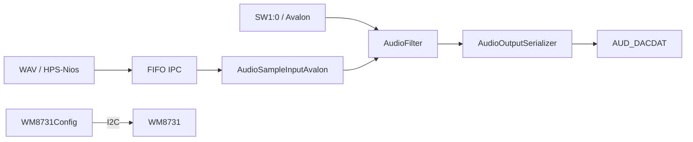

# Proyecto_2_Empotrados
Repositorio para el segundo proyecto del curso Sistemas Empotrados

# Documentación técnica

## FPGA y audio

- `../hw/docs/audio_interface.md`: arquitectura, filtros, punto fijo, relojes, tasas PCM y verificación disponible.
- `../hw/docs/memory_map.md`: contrato provisional Avalon, FIFO y registros de filtro/estado.
- `../hw/docs/quartus_review.md`: recursos, timing y clasificación de warnings Quartus.
- `../sim/README.md`: testbenches reproducibles y procedimientos físicos preparados.

## Arquitectura resumida

El estado físico no está comprobado en placa. Las simulaciones describen la lógica disponible; los procedimientos de hardware están listos para ejecución cuando exista acceso a la tarjeta.