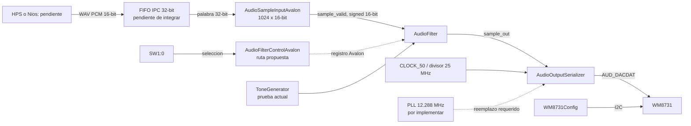
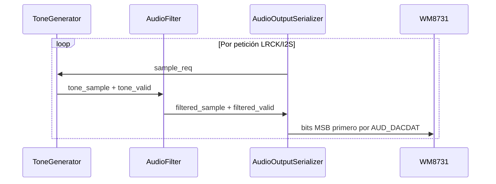
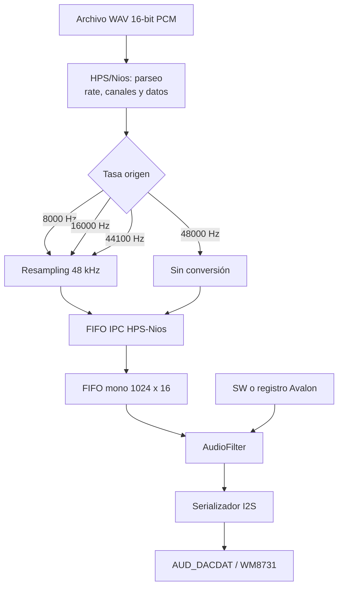
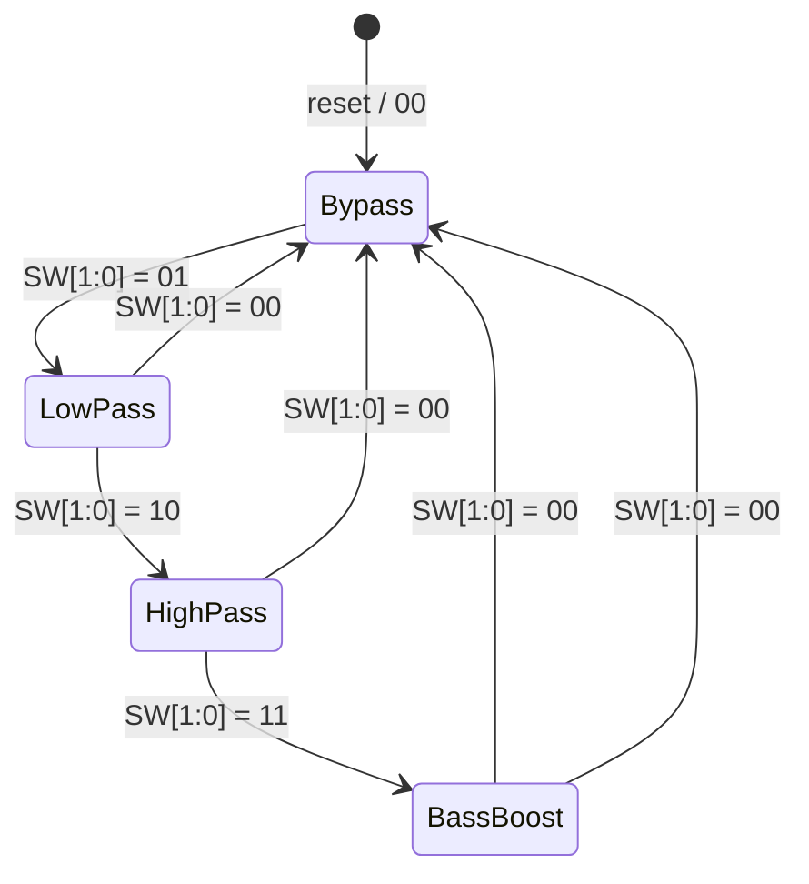
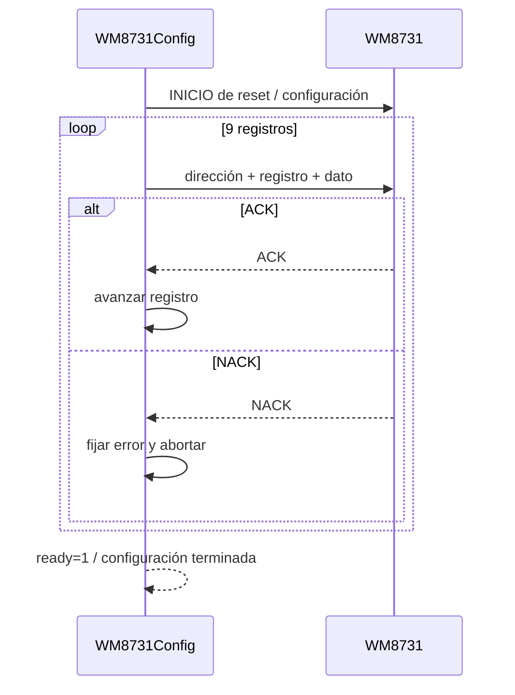
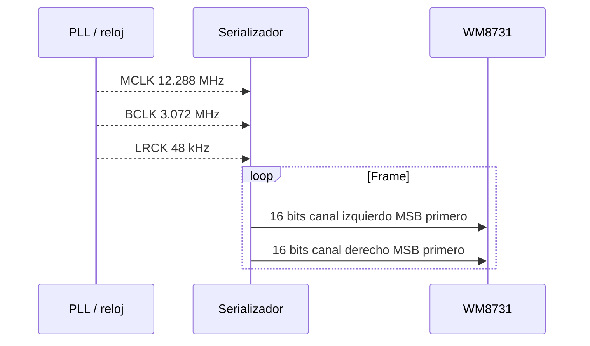

# Interfaz de audio

## 1. Estado implementado

El diseño actual usa `CLOCK_50`, un divisor de prueba para generar `AUD_XCK`, el módulo `ToneGenerator`, `AudioFilter` y `AudioOutputSerializer`. `WM8731Config` configura el códec por I2C. Los módulos `AudioSampleInputAvalon` y `AudioFilterControlAvalon` están implementados y tienen testbench propio, pero todavía no están integrados al top ni a Platform Designer.

El top sintetizado no reproduce archivos WAV ni incorpora todavía el camino HPS/Nios hacia la FIFO. Esta documentación describe el diseño existente y el contrato requerido para completar la integración sin afirmar evidencia física no disponible.



## 2. Arquitectura y flujo de datos

### 2.1 Ruta actual



La ruta actual se genera desde `SW[1:0]`, que se asigna directamente a `filter_sel`:

| Código | Modo |
|--------|------|
| `00` | bypass |
| `01` | pasa-bajos |
| `10` | pasa-altos |
| `11` | bass boost |

La FIFO de muestras conserva una capacidad de 1024 muestras de 16 bits. Su dominio de escritura usa `write_clk` y su dominio de lectura usa `audio_clk`; los punteros cruzan mediante código Gray sincronizado. El reset debe ser una señal activa baja definida por dominio y libre de reloj no válido.

### 2.2 Flujo de integración propuesto



Hasta acordar ownership, la implementación recomendada es: el software HPS/Nios decodifica el WAV, convierte a signed 16-bit y usa un único formato mono/estéreo; la FIFO IPC transporta 32 bits por beat; el hardware consume cada muestra según LRCK. No se debe mezclar mono y estéreo sin una decisión explícita.

## 3. Contrato PCM propuesto

| Campo | Contrato actual o propuesto |
|-------|-----------------------------|
| Tamaño | 16 bits por canal, `signed` en SystemVerilog |
| Word WAV | Little-endian antes de convertir; después queda representado como signed 16-bit |
| Mono | Repetir la misma muestra en izquierda y derecha |
| Estéreo | Palabra de 32 bits: `[31:16]` canal derecho, `[15:0]` canal izquierdo es la propuesta; debe congelarse antes de integrar |
| Full/overflow | Escritura rechazada si la FIFO está llena; pulso/registro sticky `overflow=1` |
| Empty/underflow | Lectura rechazada si está vacía; `underflow=1` y salida de cero o retención acordada |
| Reset | Estados, punteros y banderas vuelven a cero; los datos RAM no necesitan inicialización |
| Música multirate | El conteo de consumo debe adaptarse a la tasa de salida acordada; no cambiar solamente el metadato |

La propuesta por defecto para underflow es salida cero para evitar fabricar contenido, con sticky flag y contador si el registro de estado se integra.

## 4. Filtros

La aritmética usa números signed de 16 bits con acumuladores de 32 bits. Una cifra que excede el rango `[-32768, 32767]` se satura. El filtro propio claramente identificable puede ser el pasa-bajos $y[n]=(3x[n]+y[n-1])/4$, implementado en HDL; el pasa-altos y bass boost derivan muestras adicionales a partir del mismo estado.

| Modo | Ecuación | Estado | Latencia digital | Coeficientes |
|------|----------|--------|------------------|--------------|
| Bypass | $y[n]=x[n]$ | Ninguno | 0 ciclos | Ninguno |
| Pasa-bajos propio | $y[n]=(3x[n]+y[n-1])\gg2$ | `y_prev[15:0]` | 1 ciclo válido | $a_0=3/4$, $a_1=1/4$ |
| Pasa-altos | $y[n]=x[n]-LP[n]$ | `lp_state[15:0]` | 1 ciclo válido | resta respecto al pasa-bajos |
| Bass boost | $y[n]=x[n]+(x[n]-x[n-1])/4$ | `prev[15:0]` | 1 ciclo válido | $g_0=1$, $g_d=1/4$ |

### 4.1 Punto fijo y saturación

- Entradas/salidas: `logic signed [15:0]`.
- Diferencias y sumas temporales: `logic signed [31:0]`.
- División por 4: desplazamiento aritmético `>>> 2` y redondeo hacia cero/truncado como en el RTL actual.
- Bajo saturación: valores mayores a `32767` pasan a `16'h7fff`; menores a `-32768` pasan a `16'h8000`.
- Bypass no aplica escalado ni truncado adicional.
- El reset pone todos los estados y `out_valid` en cero.

### 4.2 Respuesta teórica esperada

```mermaid
flowchart LR
    X[x n] --> LP{Pasa-bajos<br/>y=3x+y_prev /4}
    X --> HD{x n - LP n}
    HD --> HP[Salida pasa-altos]
    LP --> LOW[Salida pasa-bajos]
    X --> DIFF{x n - x prev}
    DIFF --> Q[/ /4]
    X --> SUM{sumar}
    Q --> SUM
    SUM --> BB[Salida bass boost]
```

El pasa-bajos tiene respuesta recursiva de una polo en el dominio discreto. El término implementado corresponde a un filtro de $0.75z^{-1}$? No: para $y[n]=(3x[n]+y[n-1])/4$, la función es $H(z)=3/4/(1-z^{-1}/4)$. Esta forma es equivalente a combinar 3/4 de entrada con 1/4 de estado. El pasa-altos usa la salida de esa baja frecuencia como referencia. El bass boost realza cambios rápidos entre muestras consecutivas.

## 5. Máquina de estados y control

### 5.1 Cambio de filtro



El cambio de modo ocurre combinacionalmente al seleccionar `filter_sel`. El filtro activado es válido desde la siguiente muestra registrada según su comportamiento. Para medir latencia se debe registrar el instante de cambio de switch/registro Avalon y el instante de la primera muestra alterada en el serializador, no solamente el cambio interno de `filter_sel`.

### 5.2 Secuencia I2C



## 6. Secuencia I2S propuesta

La cadena final debe entregar al codec LRCK a la tasa de reproducción, BCLK a 32 veces LRCK para la configuración I2S de 16 bits y XCK de 256 veces LRCK, es decir 12.288 MHz a 48 kHz.



## 7. Análisis teórico de relojes y tasas

### 7.1 Estado actual

`CLOCK_50` se divide con `aud_xck_reg <= ~aud_xck_reg`, produciendo aproximadamente 25 MHz en `AUD_XCK`. El serializador usa ese reloj de audio como dominio de temporización y deriva:

- BCLK aproximado: `25 MHz / 16 = 1.5625 MHz`, según `frame_cnt[3]`.
- LRCK aproximado: `25 MHz / 256 = 97.65625 kHz`, según `frame_cnt[7]`.
- Las señales no cumplen la relación usual de 48 kHz, 32 BCLK por frame y MCLK 256x LRCK.

Por tanto, el reloj actual no está listo para el códec a 48 kHz. Debe reemplazarse por una PLL de salida y dividirla dentro de una arquitectura I2S conocida.

### 7.2 Objetivo a 48 kHz

| Señal | Frecuencia objetivo | Relación |
|-------|---------------------|----------|
| LRCK | 48 kHz | 1x |
| BCLK (16-bit I2S) | 3.072 MHz | 64x LRCK |
| MCLK/XCK | 12.288 MHz | 256x LRCK |

Para 44.1 kHz, una PLL podría entregar MCLK 11.2896 MHz, BCLK 2.8224 MHz y LRCK 44.1 kHz. La elección final debe ser única por reproducción: 48 kHz / 44.1 kHz o conversión a 48 kHz.

### 7.3 Tasas WAV

| Origen | Estrategia propuesta | Resultado objetivo |
|--------|----------------------|--------------------|
| 8 kHz | Resamplear a 48 kHz o 44.1 kHz según códec | Duración y tono no acelerados |
| 16 kHz | Resamplear a 48 kHz o 44.1 kHz | Duración y tono no acelerados |
| 44.1 kHz | Conversion lineal a 48 kHz o configurar salida a 44.1 kHz | Duración y tono correctos |

No es suficiente modificar el metadato `sample_rate`: se debe transformar el número de muestras, cambiar la tasa de consumo o usar una arquitectura de conversión de tasa. Para la entrega actual se recomienda resampling offline/firmware a 48 kHz y mantener MCLK/LRCK estables a 48 kHz.

## 8. Verificación disponible sin placa

La ejecución reproducible desde `src/` es:

```sh
./sim/run_audio_filter.sh
./sim/run_wm8731_config.sh
./sim/run_audio_fifo.sh
```

Los testbenches verifican lógica, no relojes reales, cableado, códec físico ni latencia de muestra. Los resultados observados deben registrarse junto con el commit usado.

### 8.1 Casos del testbench DSP

| Caso | Entrada | Resultado esperado | Evidencia |
|------|---------|--------------------|-----------|
| Bypass extremos | `12345`, `-23456`, `32767`, `-32768` | Igual al valor de entrada | Comparación bit a bit |
| Pasa-bajos | valores positivos, negativos y extremos | $y=(3x+y_{prev})\gg2$, saturado | Referencia independiente |
| Pasa-altos | cero, `32767`, `-32768` | entrada menos estado pasa-bajos, saturado | Referencia independiente |
| Bass boost | cero, extremos | entrada más diferencia previa/4, saturado | Referencia independiente |
| Barrido | rango `-100..100` en los tres filtros | coincide con referencia en cada muestra | 603 comparaciones por barrido |

### 8.2 I2C WM8731

| Caso | Resultado |
|------|-----------|
| ACK en nueve registros | Secuencia completa sin error y finalización |
| NACK deliberado | `error=1`, secuencia detenida y no marcado como listo |

### 8.3 FIFO Avalon

| Caso | Resultado |
|------|-----------|
| 1024 escrituras/lecturas | orden FIFO y conteo correctos |
| Full con escritura adicional | `overflow=1`, ninguna sobrescritura |
| Lectura con FIFO vacía | `underflow=1`, salida cero |
| Cruce de reloj | los punteros Gray sincronizados mantienen consistencia |

## 9. Pendientes físicos y procedimientos preparados

Los procedimientos detallados están en `src/sim/README.md`. Los criterios identificadores son:

- `AUD-01`: reset repetido, I2C, PLL, XCK, BCLK y LRCK.
- `AUD-02`: PCM conocido, alineación I2S y canal.
- `AUD-03`: bypass bit a bit y salida audible sin ruido/clipping extra.
- `SYS-01`: reproducción integrada de 30 minutos.
- `RATE-01/02/03`: WAV a 8 kHz, 16 kHz y 44.1 kHz.
- `DSP-02`: cambio de filtro medido desde acción hasta primera salida afectada, objetivo `<100 ms`.

## 10. Limitaciones conocidas

- No hay PLL ni reloj de 48 kHz comprobado.
- `AUD_XCK` actual es 25 MHz.
- El serializador personalizado no ha sido comprobado contra WM8731 físico.
- No existe reproducción de WAV ni conversión multirate.
- El bloque Avalon de control no está conectado a Platform Designer.
- No hay reporte físico de latencia, underflow sostenido ni consumo de potencia final.
- Debe acordarse con el docente si el serializador propio se acepta junto con el uso de IP/Audio de Platform Designer.
