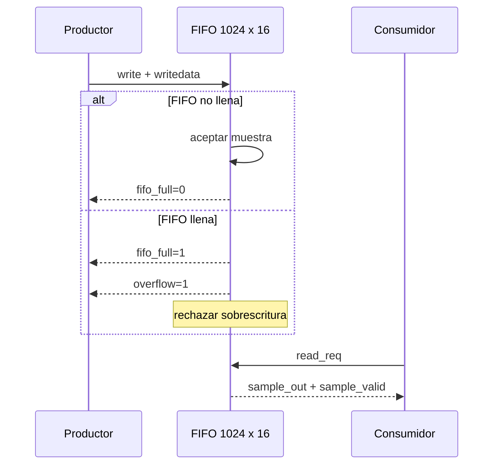
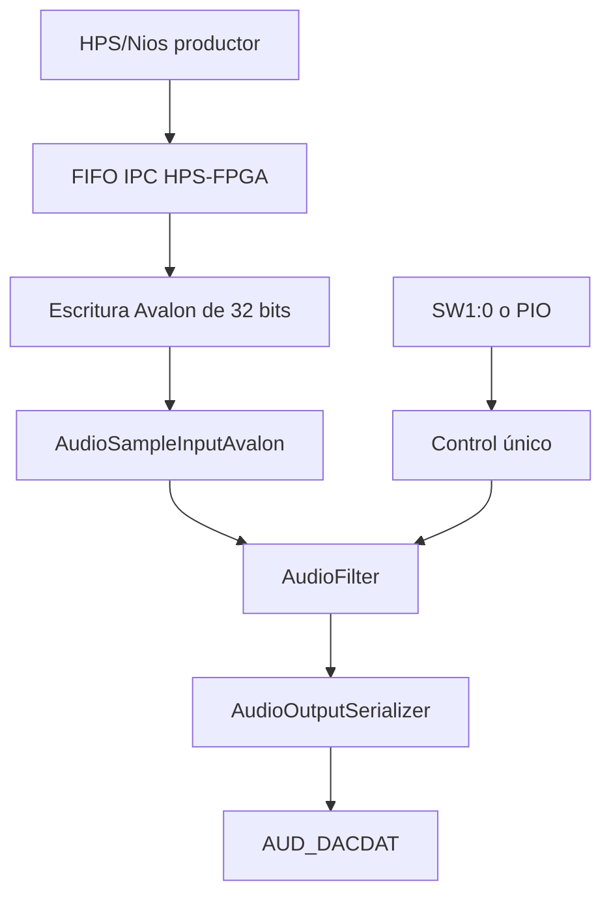

# Mapa de registros de audio

## 1. Alcance

Las bases y offsets siguientes son un contrato lógico provisional para la integración RTL. No deben interpretarse como direcciones físicas finales hasta regenerar Platform Designer y confirmar el address map generado.

## 2. Registro de control y estado

| Offset relativo | Nombre | Ancho | Acceso | Contrato |
|-----------------|--------|-------|--------|----------|
| `0x00` | `FILTER_SEL` | 32 bits | R/W | bits `[1:0]`: `00` bypass, `01` low-pass, `10` high-pass, `11` bass boost |
| `0x04` | `VOLUME` | 32 bits | R/W | bits `[7:0]`, implementación pendiente; no altera el bypass hasta acordar escala/owner |
| `0x08` | `STATUS` | 32 bits | RO | `[0] fifo_empty`, `[1] fifo_full`, `[2] underflow`, `[3] overflow`, `[4] pcm_valid`, otros bits reservados |
| `0x0C` | `PCM_DATA` | 32 bits | WO | palabra PCM propuesta según contrato mono/estéreo |
| `0x10` | `FIFO_OCCUPANCY` | 32 bits | RO | ocupación observable; implementar si el hardware expone contador de profundidad |
| `0x14` | `FIFO_UNDERFLOW_COUNT` | 32 bits | RO | contador saturante opcional para diagnóstico |
| `0x18` | `FIFO_OVERFLOW_COUNT` | 32 bits | RO | contador saturante opcional para diagnóstico |
| `0x1C` | `STATUS_CLEAR` | 32 bits | WO | escribir `1` en cada banderas para limpiar flags sticky; no necesario si la política es transitoria |

## 3. Bloque de filtros Avalon

El módulo RTL `AudioFilterControlAvalon` usa internamente los offsets `0x00`, `0x04` y `0x08`. Su implementación actual es:

| Address | Registro | Efecto actual |
|---------|----------|---------------|
| `2'b00` | filtro | copia `writedata[1:0]` a `sel_reg` |
| `2'b01` | volumen | copia `writedata[7:0]` a `vol_reg`; no se usa por el DSP actual |
| `2'b10` | estado | devuelve cero; reservado |

El reset deja el filtro en bypass y el volumen en `255`. Este volumen no tiene ganancia aplicada ni conexión al WM8731; es una reserva de interfaz.

## 4. FIFO de muestras

### 4.1 Parámetros

| Parámetro | Valor |
|-----------|-------|
| Profundidad | 1024 palabras |
| Ancho de muestra | 16 bits signed |
| Ancho Avalon de escritura | 32 bits |
| Reloj productor | `write_clk` |
| Reloj consumidor | `audio_clk` |
| Sincronización | punteros Gray y doble registro |

### 4.2 Contrato PCM

- `writedata[15:0]` contiene el sample signed 16-bit en la implementación standalone.
- Los canales mono usan el mismo valor en izquierdo y derecho.
- Para stereo debe acordarse primero el packing de 32 bits. La propuesta es izquierdo en `[15:0]` y derecho en `[31:16]`.
- La orden de bytes en memoria de WAV es little-endian; el software debe convertirla antes de escribir al bus Avalon.
- Una muestra se considera por canal en el formato mono y por frame izquierdo/derecho en el formato stereo.

### 4.3 Full y overflow

### 4.4 Empty y underflow

```mermaid
stateDiagram-v2
    [*] --> Empty: reset
    Empty --> Ready: primera escritura sincronizada
    Ready --> Ready: lecturas con datos
    Ready --> Empty: último dato consumido
    Empty --> Empty: read_req sin dato
    Empty --> Empty: underflow=1; sample_out=0
```

La política propuesta es devolver cero y declarar underflow, sin modificar el puntero. El productor debe detener o reanudar de forma explícita para evitar huecos persistentes.

## 5. Señales de control y estado

| Señal | Dominio | Descripción |
|-------|---------|-------------|
| `filter_sel[1:0]` | audio_clk / combinacional | modo activo de filtro |
| `sample_valid` | audio_clk | muestra entregada válida |
| `read_req` | audio_clk | petición de lectura de muestra |
| `fifo_full` | write_clk | FIFO llena para productor |
| `fifo_empty` | audio_clk | FIFO vacía para consumidor |
| `overflow` | write_clk, sticky/lectura | intento de escritura con FIFO llena |
| `underflow` | audio_clk, sticky/lectura | petición de lectura sin dato |

## 6. Integración pendiente

Las direcciones finales deben documentarse con el XML/SOPC generado y reemplazando los offsets relativos por las bases reales asignadas por Platform Designer.
