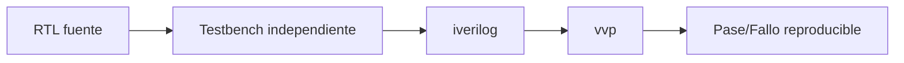
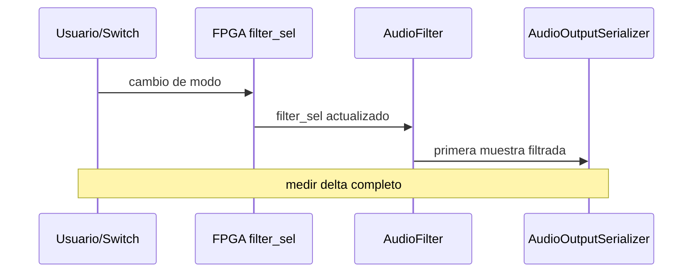

# Proyecto_2_Empotrados
Repositorio para el segundo proyecto del curso Sistemas Empotrados

# Simulación y verificación de audio

## 1. Requisitos

Desde `src/`, se necesitan Icarus Verilog e iverilog/vvp. Las pruebas no requieren la placa ni Quartus.

```sh
iverilog -V
vvp -V
```

## 2. Ejecución desde la raíz del repositorio

```sh
./src/sim/run_audio_filter.sh
./src/sim/run_wm8731_config.sh
./src/sim/run_audio_fifo.sh
```

Las pruebas escriben sus ejecutables temporales bajo `/tmp`; no agregan archivos HDL al proyecto QSF.



## 3. Testbench de filtros

| ID | Entrada | Resultado esperado |
|----|---------|--------------------|
| FIL-01 | bypass: `12345`, `-23456`, `32767`, `-32768` | Salida igual al input, sin escalado |
| FIL-02 | low-pass: positivos, negativos y extremos | $(3x+y_{prev})/4$, truncado y saturado |
| FIL-03 | high-pass: cero, extremos | $x-LP(x)$, truncado y saturado |
| FIL-04 | bass boost: cero y extremos | $x+(x-x_{prev})/4$, truncado y saturado |
| FIL-05 | recorridos `-100..100` en los tres modos | Coincidencia con modelo independiente |

Comando:

```sh
./src/sim/run_audio_filter.sh
```

Resultado observado actual: `PASS: tb_AudioFilter completed without errors`.

## 4. Testbench WM8731 I2C

Comando:

```sh
./src/sim/run_wm8731_config.sh
```

| Caso | Resultado esperado |
|------|--------------------|
| ACK en todos los registros | los nueve registros se transmiten y `ready/error` llegan al estado correcto |
| NACK deliberado | la máquina fija error y aborta en lugar de continuar |

Resultado observado actual: pasa secuencia y manejo NACK.

## 5. Testbench FIFO Avalon

Comando:

```sh
./src/sim/run_audio_fifo.sh
```

| Caso | Entrada | Resultado esperado |
|------|---------|--------------------|
| FIFO-01 | 1024 muestras 16-bit | orden correcto y ocupación sin pérdida |
| FIFO-02 | escritura adicional estando llena | `overflow=1`, sin sobrescritura |
| FIFO-03 | lectura estando vacía | `underflow=1`, muestra cero |
| FIFO-04 | cruces de reloj | punteros Gray sincronizados y consistencia CDC |

Resultado observado actual: `PASS: AudioSampleInputAvalon 1024-entry FIFO, order, overflow, underflow`.

## 6. Procedimientos físicos pendientes

Las siguientes pruebas requieren placa, fuente de audio o señal conocida, auriculares y osciloscopio/analizador lógico.

### 6.1 AUD-01 — Reset, reloj y configuración

| Paso | Acción | Resultado esperado | Evidencia |
|------|--------|--------------------|-----------|
| 1 | Pulsar reset 10 veces | arranque repetible | foto de consola/led |
| 2 | Observar I2C | nueve registros ACK | captura I2C |
| 3 | Medir XCK | 12.288 MHz esperado a 48 kHz | captura BNC |
| 4 | Medir BCLK | 3.072 MHz esperado | captura lógica |
| 5 | Medir LRCK | 48 kHz | captura lógica |

Tabla de registro:

| Ejecución | PLL lock | XCK kHz | BCLK kHz | LRCK Hz | I2C ACK | Estado |
|-----------|----------|---------|----------|---------|---------|--------|
| 1 | | | | | | |
| 2 | | | | | | |
| 3 | | | | | | |

### 6.2 AUD-02 — Patrón PCM/I2S

Preparar patrones: silencio, impulso, alternancia, `0x7fff`, `0x8000`, cuadrado de canal izquierdo y cuadrado de canal derecho.

| Patrón | Entrada | Verificación esperada |
|--------|---------|-----------------------|
| Silencio | `0x0000` | DACDAT permanece cero salvo protocolo esperado |
| Impulso | una muestra `0x7fff` seguida de ceros | una muestra por canal, sin desplazamiento |
| Máximo positivo | `0x7fff` | sin saturación interna en bypass |
| Máximo negativo | `0x8000` | no se cambia a `0x7fff` |
| L/R distinto | izquierda `0x4000`, derecha `-0x4000` | canales no intercambiados |

Medir MSB primero, 16 bits por canal, alineación de LRCK y ausencia de inversión.

### 6.3 AUD-03 — Bypass sin distorsión

| Paso | Acción | Evidencia |
|------|--------|-----------|
| 1 | Capturar entrada signed 16-bit | archivo/vector de referencia |
| 2 | Configurar bypass | captura DACDAT o audio |
| 3 | Comparar muestras reconstruidas | diferencia bit a bit, excluyendo latencia |
| 4 | Escuchar/grabar salida | descripción de audibilidad y captura |

Criterio: diferencia esperada cero respecto a las muestras de entrada sin ganancia o recorte adicional.

### 6.4 DSP-02 — Cambio de filtro <100 ms



| Ejecución | Inicio (switch/registro) | Fin (primera salida) | Delta ms | Resultado |
|-----------|--------------------------|----------------------|----------|-----------|
| 1 | | | | |
| 2 | | | | |
| 3 | | | | |

Criterio objetivo: peor caso medido `<100 ms`.

### 6.5 Pruebas multirate

Los archivos se pueden generar con el script reproducible `src/sim/vectors/create_test_wav.py`. Omitir un script generado no altera el RTL.

| ID | Tasa WAV | Archivo objetivo | Verificación |
|----|----------|------------------|--------------|
| RATE-01 | 8 kHz | 440 Hz por 2 segundos | duración 2 s, tono correcto |
| RATE-02 | 16 kHz | 440 Hz por 2 segundos | duración 2 s, tono correcto |
| RATE-03 | 44.1 kHz | 440 Hz por 2 segundos | duración 2 s, tono correcto |

Para 8 y 16 kHz se debe probar el resampling a la salida de 48 kHz. Para 44.1 kHz se debe medir si el sistema convierte a 48 kHz o cambia la salida a 44.1 kHz.

### 6.6 SYS-01 — Reproducción integrada de 30 minutos

| Punto | Valor |
|-------|-------|
| Duración objetivo | 30 minutos |
| Cambios de pista | al menos uno |
| Cambios de filtro | todos los modos |
| Play/pause/stop | si están integrados |
| Estado FIFO | registrar bajo, normal y alto |
| Resultado bajo | |
| Resultado esperado | no reinicios, cuelgues, desync ni underflow sostenido |

## 7. Evidencia mínima

Archivar:

- salida de consola de los tres testbenches;
- commit/branch usado;
- capturas de I2C, XCK, BCLK, LRCK y DACDAT;
- grabación o captura de audio del bypass;
- tabla de tiempos de cambio de filtro;
- tabla de tasas WAV y duración/tono medidos;
- reportes Quartus y warnings.

No archivar rutas locales absolutas ni nombres de máquinas personales.